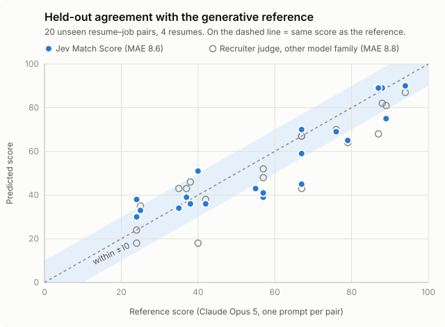

# fast-resume-scoring

Resume scoring powered by [Jev](https://docs.typesafe.ai/introduction). Score your resume against a job posting in under a second, for $0.0001. Use the right tools for the right job.

[](https://github.com/dphbfs/fast-resume-scoring/actions/workflows/ci.yml)
[](https://scorecard.dev/viewer/?uri=github.com/dphbfs/fast-resume-scoring)
[](https://github.com/dphbfs/fast-resume-scoring/releases/latest)
[](LICENSE)
[](docs/final-report-v1.md)

### Why it's worth adding to your job search:

- **Fast.** About 18× faster than a frontier-model prompt. Under a second
  per score, and 20 pairs take about 2 s with 4 running in parallel. The
  Opus prompt took 76 s for the same 20.
- **Cheap.** At least 300× cheaper than a frontier-model prompt. About
  $0.0001 per score, so 10,000 scores cost $1. The frontier-model prompt
  costs at least $0.033 per score.
- **Fits your workflow.** It works as a CLI, as an MCP server so your agent (Claude Code, Codex, pi) can score postings for you, or in Docker.
- **Accurate.** On a held-out set it agrees with Claude Opus 5 within 8.6
  points on average. An independent frontier-model judge landed at 8.8,
  so it's as close as a second opinion.
- **Explainable.** Every score comes with its three signals. `extract` and
  `check` quote the resume lines behind each requirement, and `-debug`
  writes a trace of every question asked.
- **Tunable and measurable.** All prompts and weights live in one YAML
  file, and the eval commands show whether your change helped.


## Install

Prerequisites:

- A Jev API key from [TypeSafe](https://docs.typesafe.ai/introduction) or
  [OpenRouter](https://openrouter.ai). To look around first, the
  [no-key demo](#try-it-without-a-key) runs on a recording.

For Linux and macos users:

```sh
// For macos and linux users

curl -fsSL https://raw.githubusercontent.com/dphbfs/fast-resume-scoring/main/install.sh | bash

// or

curl -fsSL https://raw.githubusercontent.com/dphbfs/fast-resume-scoring/main/install.sh \
  | bash -s -- --installation-dir /usr/local/bin
```

> Windows users use a **release archive** or **Docker**.

Other ways to install:

- Download an **release archive** for Linux, macOS, or Windows from
  [Releases](https://github.com/dphbfs/fast-resume-scoring/releases/latest).
  Each one holds the four binaries, `tuning.yaml`, and `.env.example`.
- With **Docker** (linux/amd64 and linux/arm64). The image
  `ghcr.io/dphbfs/fast-resume-scoring` has all four binaries, the
  examples, and the default tuning file at
  `/etc/fast-resume-scoring/tuning.yaml`.
- From a clone: `make build` puts the binaries in `bin/`.
- With Go 1.27.2 or newer:
  ```sh
  go install github.com/dphbfs/fast-resume-scoring/cmd/{score,extract,check,resume-scoring-mcp}@latest
  ```

## Usage

Set the key once:

```sh
export TYPESAFE_API_KEY=...                       # TypeSafe key
# or, for OpenRouter:
# export TYPESAFE_BASE_URL=https://openrouter.ai/api TYPESAFE_API_KEY=<OpenRouter key>
```

### Command line

```sh
# Match Score, 0 to 100
score -jd job.txt -resume resume.md

# Why: what the job asks for, then what the resume covers
extract -o requirements.json job.txt
check -requirements requirements.json -resume resume.md -o coverage.json
```

`check` writes Coverage per requirement, the gaps among required items,
and a Fit Score, with the resume lines it relied on:

```jsonc
// coverage.json (trimmed, illustrative values)
{
  "requirements": [
    {
      "id": "req_1",
      "value": "Kubernetes",
      "tier": "required",
      "coverage": "partial",
      "evidence": [{ "unit": "e4", "strength": "partial", "p": 0.71 }],
    },
  ],
  "fit": {
    "score": 57,
    "by_tier": { "required": 58, "preferred": 50 },
    "gaps": ["req_5"],
  },
  "evidence_units": {
    "e4": {
      "text": "Migrated 30 services to EKS ...",
      "role": "Backend Engineer",
    },
  },
}
```

| Flag          | Commands           | Meaning                                                                               |
| ------------- | ------------------ | ------------------------------------------------------------------------------------- |
| `-o FILE`     | all                | Write the JSON to a file instead of stdout                                            |
| `-q`          | all                | Skip the run summary (tokens, cost, latency) on stderr                                |
| `-debug FILE` | `extract`, `check` | Write a trace of every question, its probabilities, and what was accepted or rejected |

Exit codes: 0 on success, 1 when the run fails, 2 for bad arguments or
unreadable input.

With Docker, mount the working directory:

```sh
docker run --rm -e TYPESAFE_API_KEY -v "$PWD:/work" \
  ghcr.io/dphbfs/fast-resume-scoring score -jd job.txt -resume resume.md
```

### MCP server

`resume-scoring-mcp` serves the same three operations as MCP tools:

| Tool      | Input                                                  | Output                                               |
| --------- | ------------------------------------------------------ | ---------------------------------------------------- |
| `score`   | `job_description`, `resume` (text)                     | Match Score and its three signals                    |
| `extract` | `job_description` (text)                               | Requirements with Tier, Importance, and alternatives |
| `check`   | `requirements` (the `extract` result), `resume` (text) | Coverage, gaps, Fit Score, quoted evidence           |

The tools take text, so the client reads the files and passes their
contents. PDF resumes work with the command-line tools only.

Here Claude Code reads both files, calls `score`, and reports Jev's
answer:


Over stdio, with Claude Code:

```sh
claude mcp add fast-resume-scoring --env TYPESAFE_API_KEY="$TYPESAFE_API_KEY" -- resume-scoring-mcp
```

With Claude Desktop or any client that reads an `mcpServers` config:

```json
{
  "mcpServers": {
    "fast-resume-scoring": {
      "command": "/home/you/.local/bin/resume-scoring-mcp",
      "env": {
        "TYPESAFE_API_KEY": "...",
        "TUNING_FILE": "/home/you/.config/fast-resume-scoring/tuning.yaml"
      }
    }
  }
}
```

Over streamable HTTP, for example in Docker on a home server:

```sh
export MCP_HTTP_TOKEN=$(openssl rand -hex 32)
docker run -d --name resume-scoring -p 8080:8080 \
  -e TYPESAFE_API_KEY -e MCP_HTTP_TOKEN \
  ghcr.io/dphbfs/fast-resume-scoring \
  resume-scoring-mcp -transport http -addr 0.0.0.0:8080

claude mcp add --transport http fast-resume-scoring http://localhost:8080/mcp \
  --header "Authorization: Bearer $MCP_HTTP_TOKEN"
```

The endpoint is `/mcp`, and `/healthz` answers `ok`. HTTP listens on
`127.0.0.1:8080` by default. The server refuses to start on any
non-loopback address unless `MCP_HTTP_TOKEN` is set, and then every
request needs `Authorization: Bearer <token>`.

### Try it without a key

[`examples/`](examples/) holds a synthetic posting and resume, the output
of every command on them, and a recording of the Jev calls behind it. The
recording answers the same requests offline:

```sh
git clone https://github.com/dphbfs/fast-resume-scoring && cd fast-resume-scoring
make build
JEV_REPLAY=examples/jev-recording.json OPENAI_MODEL= \
  bin/score -jd examples/job.md -resume examples/resume.md

# or with Docker
docker run --rm -e JEV_REPLAY=/examples/jev-recording.json \
  ghcr.io/dphbfs/fast-resume-scoring score -jd /examples/job.md -resume /examples/resume.md
```

A replay only knows the requests it recorded, so your own files need a
key.

### Input format

Job descriptions can be plain text or Markdown with any structure; the
first non-empty line is taken as the title. Resumes are read best in this
layout, and anything else still works with blank role metadata:

```markdown
# Experience

## Backend Engineer | Acme | 2021-03 – 2024-06

- Built the billing service in Go on Kubernetes.

# Skills

Languages: Go, Python, SQL
```

`score` and `check` also accept PDF resumes (`-resume resume.pdf`). The
text is extracted locally in a child process, and known headings
("Experience", "Skills", ...) and bullet glyphs are converted to the
layout above. Scanned PDFs without a text layer are rejected because there
is no OCR. Two-column PDFs are read one column at a time, so `check` may
attach a date or role line to the wrong entry; `score` reads the whole
text and is unaffected.

Each text input, including text extracted from a PDF, may be up to 48 KiB.
A PDF file may be up to 10 MiB.

## Features

- `score` returns a 0 to 100 Match Score from one Jev request, along with
  the three signals it was computed from.
- `extract` splits a job description into atomic requirements ("Go",
  "Kubernetes", "5+ years backend"). Each has a tier (required, preferred,
  or mentioned), an importance, its alternatives ("Go or Ruby"), and the
  sentences it came from.
- `check` links resume lines to those requirements and grades Coverage as
  strong, partial, weak, or none. It reports the gaps among required items
  and a Fit Score, and quotes the evidence.
- `extract` and `check` can write a trace of every question asked, its
  probabilities, and whether the answer was accepted.
- Every prompt and weight lives in one YAML file that you can edit without
  rebuilding. A snapshot test pins the prompts, and the `eval` command
  measures changes against hand-labeled data and reference scores.
- The runtime has bounded concurrency and retries, a deadline per run,
  input size limits, structured logs, a per-run summary of tokens, cost,
  and p50/p95 latency, sanitized provider errors, and private output
  files.

## How it works

`score` asks Jev three questions about the whole posting and resume in a
single request:

| Signal             | Type            | Question                                                                            |
| ------------------ | --------------- | ----------------------------------------------------------------------------------- |
| `role_match`       | Score, 5 levels | How closely does the candidate's kind of role match this job's?                     |
| `experience_short` | yes/no          | Clearly fewer years, or a clearly lower level, than the job asks for?               |
| `blocker`          | yes/no          | A stated status condition (student, clearance, license, citizenship) clearly unmet? |

`match = (80.7 + 18.5·role_match − 55.2·experience_short) × (1 − blocker)`,
clamped to 0 to 100. The weights were fitted to generative reference scores
and live in [`tuning/tuning.yaml`](tuning/tuning.yaml).

`extract` and `check` run a longer pipeline of narrow Jev questions:
section labeling, candidate selection, refinement, retrieval, and evidence
checks that gate first and grade second. See
[docs/architecture.md](docs/architecture.md).

## Results

The reference is one Claude Opus 5 match-score call per pair, the usual
generative approach. The second judge is an independent recruiter-style
rubric run on a different model family (3 runs, median). Intervals are
95% pair bootstraps with 2,000 resamples.

| Set                                                 | Pairs | MAE vs reference | Kendall τ-b       | Within ±10 |
| --------------------------------------------------- | ----- | ---------------- | ----------------- | ---------- |
| Development                                         | 50    | 5.0              | 0.83–0.88         | 87–90%     |
| Held out (sealed)                                   | 20    | 8.6 [6.0, 11.1]  | 0.78 [0.63, 0.92] | 60%        |
| _Independent judge vs reference, same held-out set_ | 20    | _8.8_            | _0.78_            |            |



|                         | Jev                         | Opus 5 prompt       |
| ----------------------- | --------------------------- | ------------------- |
| Cost per score          | $0.0001                     | ≥ $0.033            |
| Latency, mean           | 0.3 s in process, 0.8 s CLI | 14.1 s (p95 20.4 s) |
| 20 pairs, 4 in parallel | ~2 s                        | 76 s                |

The generative reference moves too. The same pairs scored a few days
apart shifted by +11.6 points on average, and the same resume sent as
Markdown instead of JSON scored 14.9 points lower. The method is in
[docs/eval.md](docs/eval.md) and the full numbers are in
[docs/final-report-v1.md](docs/final-report-v1.md).

### Limitations

- The evaluation is small: 70 scored pairs and 9 resumes in total, so the
  intervals are wide.
- Career changers are under-scored on roles in their new field.
- Off-role or location-restricted postings can be over-scored by 10 to 15
  points. Location is deliberately not a blocker.
- Only English has been tested, on software, data, and security roles.
- Use the score to screen. It should not make a hiring decision.

## Configuration

Settings come from environment variables. [`.env.example`](.env.example)
lists all of them with defaults; these are the ones you are most likely to
change:

| Variable                                              | Default                   | Purpose                                                                      |
| ----------------------------------------------------- | ------------------------- | ---------------------------------------------------------------------------- |
| `TYPESAFE_API_KEY`                                    | (required)                | Jev key (TypeSafe or OpenRouter)                                             |
| `TYPESAFE_BASE_URL`                                   | `https://api.typesafe.ai` | `https://openrouter.ai/api` for OpenRouter                                   |
| `JEV_MODEL`                                           | `jev-latest`              | Pin a version, e.g. `jev-1.13`                                               |
| `JEV_MAX_CONCURRENCY`                                 | `8`                       | Parallel Jev requests                                                        |
| `TUNING_FILE`                                         | built in                  | Path to your edited `tuning.yaml`                                            |
| `RUN_DEADLINE`                                        | `120s`                    | Time limit for one command or tool call                                      |
| `OPENAI_BASE_URL` / `OPENAI_API_KEY` / `OPENAI_MODEL` | unset                     | Optional generative model that writes `extract`'s Job Summary                |
| `JEV_RECORD` / `JEV_REPLAY`                           | unset                     | Save every Jev exchange to a file, or answer from one with no key or network |
| `MCP_HTTP_TOKEN`                                      | unset                     | Bearer token for `resume-scoring-mcp -transport http`                        |
| `LOG_LEVEL`                                           | `info`                    | `debug`, `info`, `warn`, or `error` (JSON logs on stderr)                    |

## Tuning

The binaries embed a default [`tuning/tuning.yaml`](tuning/tuning.yaml).
Point `TUNING_FILE` at an edited copy to change behavior without
rebuilding. The install script puts one at
`~/.config/fast-resume-scoring/tuning.yaml`. Every `score` output records
the first 12 hex characters of the file's hash in `tuning`, so you can
tell which file produced a result.

The file covers:

- `match_score`: the intercept and the weights for `role_match` and
  `experience_short`.
- `fit_score`: the credit for each Coverage strength and the weight of
  each tier.
- `holistic`: the three questions behind `score`, with the `role_match`
  levels and the yes/no descriptions.
- `extractor` and `checker`: every question, option, and example used by
  `extract` and `check`.

Option names marked `# fixed` are read by the code and cannot be renamed.
Everything else can be reworded.

To try a change on one pair:

```sh
cp ~/.config/fast-resume-scoring/tuning.yaml my-tuning.yaml
# edit my-tuning.yaml
TUNING_FILE=my-tuning.yaml score -jd job.txt -resume resume.md
```

To measure whether it is better, run the evals from a clone. They call
live Jev, cost real money, and write dated JSON and Markdown reports to
`eval/reports/`:

```sh
cp .env.example .env            # add TYPESAFE_API_KEY
TUNING_FILE=my-tuning.yaml make eval-e2e       # Match Score vs the reference scores
TUNING_FILE=my-tuning.yaml make eval           # extract vs hand-labeled requirements
TUNING_FILE=my-tuning.yaml make eval-checker   # check vs hand-labeled evidence links
```

Then compare MAE, Kendall τ-b, and the within-±10 share against a run
with the default file. Jev's answers vary by about 0.5 points between
identical runs, so run each configuration at least 3 times and compare
the means.

The Match Score weights were fitted to the exact wording of the
`holistic` questions. If you reword one, refit before you trust the
score: `scripts/probe_holistic.py` asks candidate questions over the
development pairs, and `scripts/fit_match.py` refits the weights and
reports resume-held-out error. [ADR 0004](docs/adr/0004-match-score-from-the-holistic-round.md)
explains why, and [docs/tuning.md](docs/tuning.md) logs every experiment
so far, including the ones that lost.

## Documentation

- [Architecture](docs/architecture.md): pipeline and code layout
- [Evaluation method](docs/eval.md): data sets, metrics, experiment rules
- [Examples](examples/): real outputs and a no-key replay
- [CONTEXT.md](CONTEXT.md): glossary of domain terms
- [Decision records](docs/adr/)
- [Tuning log](docs/tuning.md)
- [Final evaluation report](docs/final-report-v1.md)

## Contributing

Issues, eval fixtures, and pull requests are welcome. Read
[CONTRIBUTING.md](CONTRIBUTING.md) first; changes to scoring need
measurements over several runs. Please follow the
[Code of Conduct](CODE_OF_CONDUCT.md) and report security issues
privately as described in [SECURITY.md](SECURITY.md).

## License

[Apache License 2.0](LICENSE).
